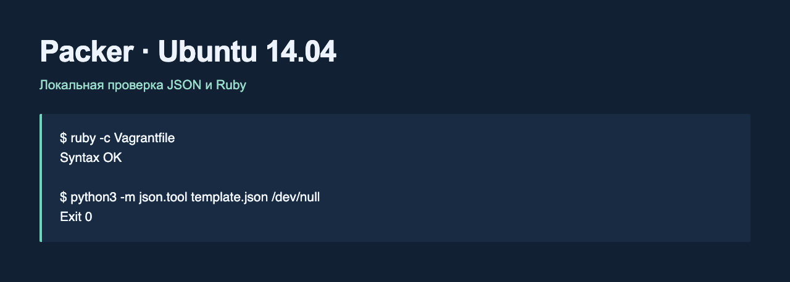
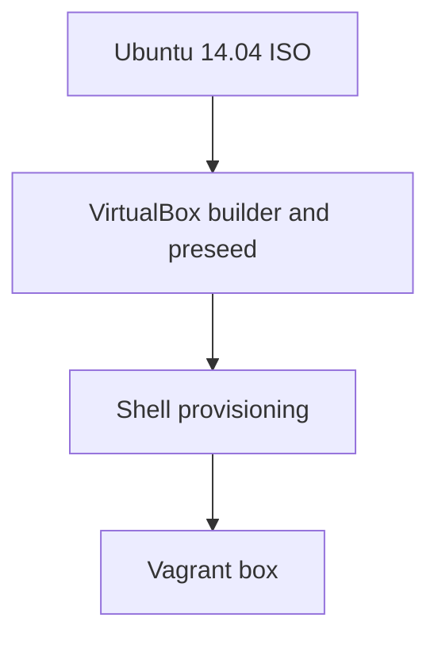

# Packer · Ubuntu 14.04 Lab

A historical Packer exercise that builds an Ubuntu 14.04 amd64 VM in VirtualBox, runs shell provisioning and packages it as a Vagrant box. The repository also includes Chef recipes for separate exercises.

[Demo](#demo) · [Repository map](#repository-map) · [PDF slides](docs/readme/overview.pdf) · [AGENTS.md](AGENTS.md)

## Demo



Local syntax checks for the Packer template and Vagrantfile.

1. Inspect the template and validate the JSON and Vagrantfile.
2. For a full build, configure a trusted compatible amd64 ISO and verify its checksum independently.
3. Run the template only in a disposable environment with compatible Packer and VirtualBox tooling.

## How it works



## Repository map

| File or directory | Purpose |
| --- | --- |
| [`template.json`](template.json) | VirtualBox builder, provisioners and Vagrant packaging |
| [`http/preseed.cfg`](http/preseed.cfg) | Ubuntu installer answers |
| [`scripts`](scripts) | Shell provisioning and image cleanup |
| [`Vagrantfile`](Vagrantfile) | Separate Vagrant configuration |
| [`recipes`](recipes) | Chef exercise recipes |

## Inspect the build definition

```sh
python3 -m json.tool template.json /dev/null
ruby -c Vagrantfile
```

A historical build uses `packer build template.json` and produces `ubuntu-14.04-server-amd64.box`. Set the local ISO path before attempting it. The installer, checksum format, guest access and toolchain are historical, so keep any build isolated. The original README listed MySQL installation as unfinished.
